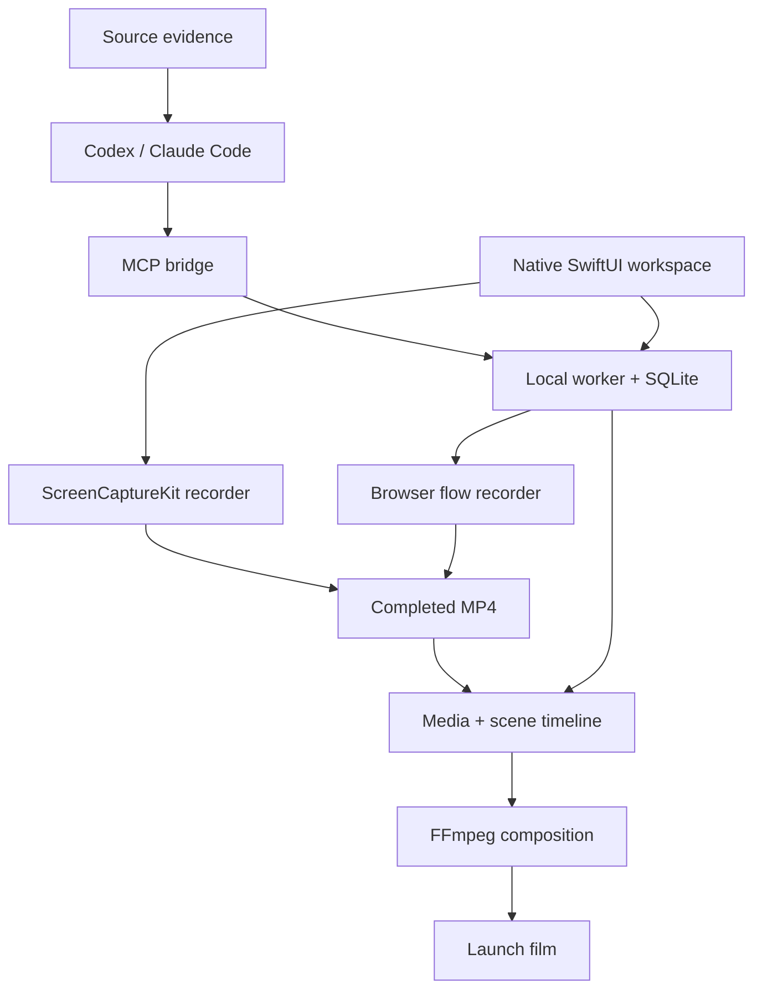

# Architecture — Frameva 0.2

Frameva separates native interaction/capture from the portable local project and
render worker. The source reader discovers candidates; the coding agent plans
and validates journeys; actual recordings provide the visible product footage.

## Native process and capture

The macOS15+ SwiftUI/AppKit app starts or connects to an authenticated loopback
worker. The bundled helper contains the Python environment; the frontend uses
URLSession API requests and downloads media into a private cache for AVKit.
It does not embed the browser studio as its UI. The same persistent worker/API
is used by MCP, avoiding separate project states for a human and coding agent.

The ScreenCaptureKit system picker selects recording content. SCRecordingOutput
writes the real stream to MP4. Completion is a separate delegate event: stopping
the stream alone does not prove the file is finalized. The native recorder waits
for completion before importing the media. Microphone access is opt-in and uses
system consent. Native capture is interactive: the person operates the target
app. It is not autonomous automation of arbitrary Mac apps.

## Source and flow evidence

Repository and ZIP scans are bounded, read-only and do not execute code. Feature
candidates have source references. A FlowInput contains validated actions,
same-origin navigation, selectors, expected visible text and optional exact
feature-title mappings. Imported source text does not authorize tool execution.

Browser capture uses a clean Chromium profile and continuous video. The recorder
runs explicit clicks, fills, key presses, scrolling, holds and assertions. A fixed
cursor/click overlay is captured in the page pixels. A failed action/assertion,
blocked navigation, timeout or cancellation cannot publish a successful partial
recording. The context closes before its video is processed. Browser capture does
not capture system audio; native window recording can.

The media asset contains a report of passed steps and approximate times. Exact
feature-title mappings connect completed flow snapshots to source candidates.
Unrecorded features and edited plans stay visible. This is recorded coverage,
not behavioral correctness or exhaustive code coverage. Native manual recordings
are usable footage but do not manufacture automated step assertions.

## Persistent queue

SQLite stores projects, scenes, flow plans, source evidence, media metadata,
workflow definitions and immutable job parameter snapshots. A serial worker
records or renders one job at a time. Jobs have persistent sequence numbers for
FIFO and newest-render selection. A retry creates a new job with the original
snapshot. Asset/job/project completion is atomic; cancelled work cannot publish.
Project deletion and asset deletion respect pending jobs and media references.

## Composition

Recording scenes use actual video frames. FFmpeg applies trim, playback rate,
focus/zoom, aspect-fit framing and a Pillow-drawn background/title/caption layer.
A requested duration that exceeds the source footage is rejected. Optional source
audio is speed-adjusted with the video. The static background does not replace
the live content. Preview scenes remain useful for title/CTA and still assets.

Exports normalize scenes, retain or synthesize silent audio streams, then join
with cuts or crossfades. Crossfade overlap shortens total runtime by the overlap
at each boundary. Optional soundtrack audio is mixed below preserved source audio
with fades and limiting. The current mix level is fixed; it is not a multitrack
DAW. Optional ComfyUI shots can supply generated b-roll separately.

## Distribution and limits

The native build uses SwiftPM plus a PyInstaller onedir helper application in
Contents/Helpers. A Mac SDK, matching-architecture dependencies and appropriate
signing are required. ScreenCaptureKit is macOS-only. The portable Python worker
and legacy web interface remain available on Windows/Linux. Browser recording
needs optional Playwright and an installed Chromium browser. GPU inference is
separate and not necessary for recording or CPU composition.

The supplied CI configuration is not evidence of an executed native build.
[VERIFICATION.md](VERIFICATION.md) records what was actually run.
